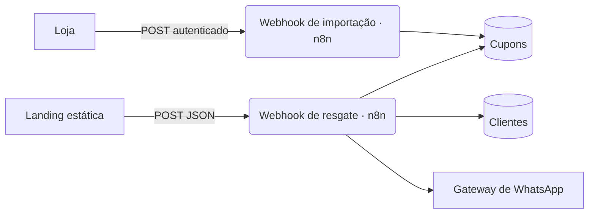

<div align="center">


# Goostozinhos · Resgate de cupons

Landing de pós-venda com raspadinha digital, entrega do cupom por WhatsApp e automação em n8n.

[**Ver a landing**](https://goostozinhos.onrender.com) · [**Documentação**](https://goostozinhos.onrender.com/docs/) · [Referência de API](https://goostozinhos.onrender.com/docs/referencia-api.html)


</div>

---

## O que é

A Goostozinhos envia cartas com QR Code para os clientes. O QR leva a uma página curta que transforma o agradecimento em presente:

1. **Instagram:** o cliente abre o perfil da loja e informa o @.
2. **Avaliação:** o cliente avalia o pedido no Pedidos10.
3. **Resgate:** o cliente informa nome e WhatsApp e raspa o cartão dourado para revelar o cupom.

O código aparece na tela e chega por WhatsApp. Cada telefone recebe um cupom por campanha.

## Como funciona



| Camada | O que faz |
|---|---|
| **Landing** (`public/`) | Três passos, máscara de telefone, raspadinha em canvas com alternativa acessível, progresso salvo por 24 h |
| **Resgate** (n8n) | Valida, decide a entrega, reivindica o envio com trava condicional e reverte se o WhatsApp falhar |
| **Importação** (n8n) | Um cupom por chamada, protegida por header, recusa código duplicado e campanha já ativa |
| **Documentação** (`docs-src/`) | Markdown transformado em site estático em `/docs` |

## Destaques técnicos

- **Idempotência por telefone:** repetir o resgate mostra o mesmo código de novo, sem segundo envio de WhatsApp.
- **Concorrência segura:** a atualização condicional garante um único vencedor quando chegam pedidos simultâneos.
- **Falha não perde o cupom:** se o WhatsApp cair, o cliente sai com o código na tela e o estado fica `pendente`.
- **Acessibilidade:** contraste AA, navegação completa por teclado, botão "Revelar sem raspar" e respeito a `prefers-reduced-motion`.
- **Zero dependências:** o frontend não tem build, e os testes rodam com Python e Node puros.

## Rodar localmente

```bash
python3 docs-src/build.py                 # gera public/docs
python3 -m http.server 8000 -d public     # http://localhost:8000 e /docs
```

## Estrutura

```
public/          landing publicada (HTML, CSS, JS, mídia)
public/docs/     documentação gerada, não editar à mão
docs-src/        fonte da documentação (content/*.md + build.py)
render.yaml      site estático no Render
```

## Deploy

Cada push na branch `main` publica no Render como site estático. O build roda `python3 docs-src/build.py` e serve a pasta `public/`.

---

<div align="center"><sub>Feito para a Goostozinhos Confeitaria Artesanal.</sub></div>
