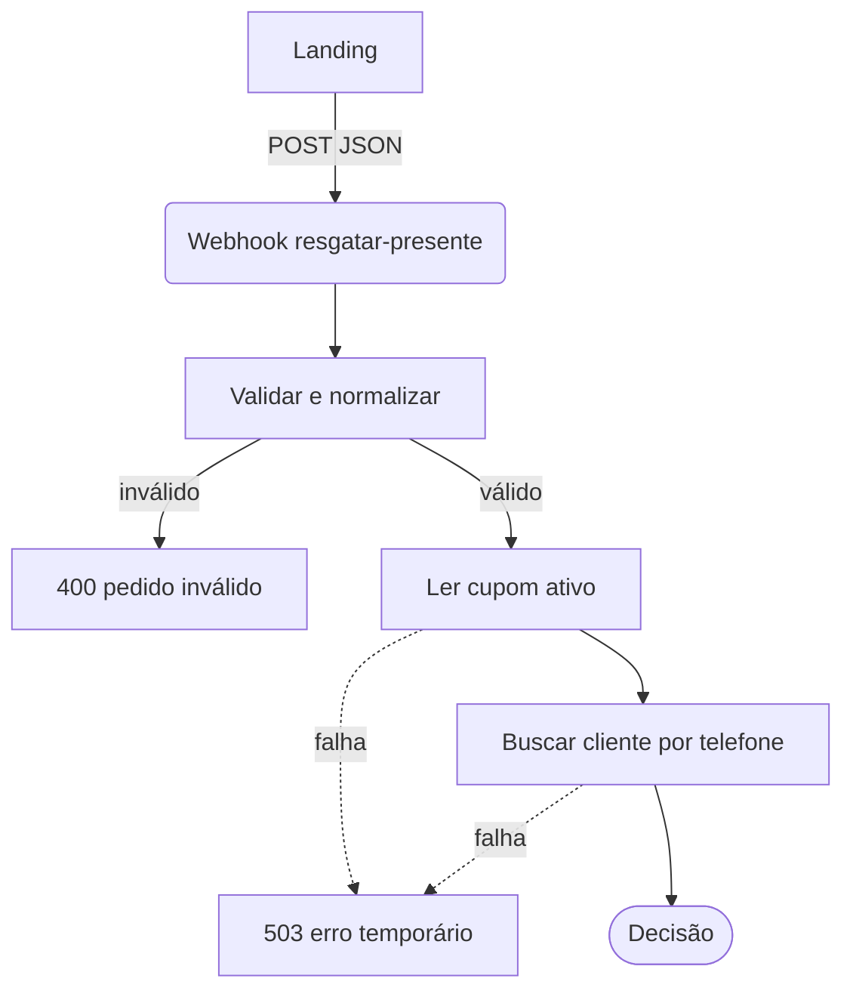
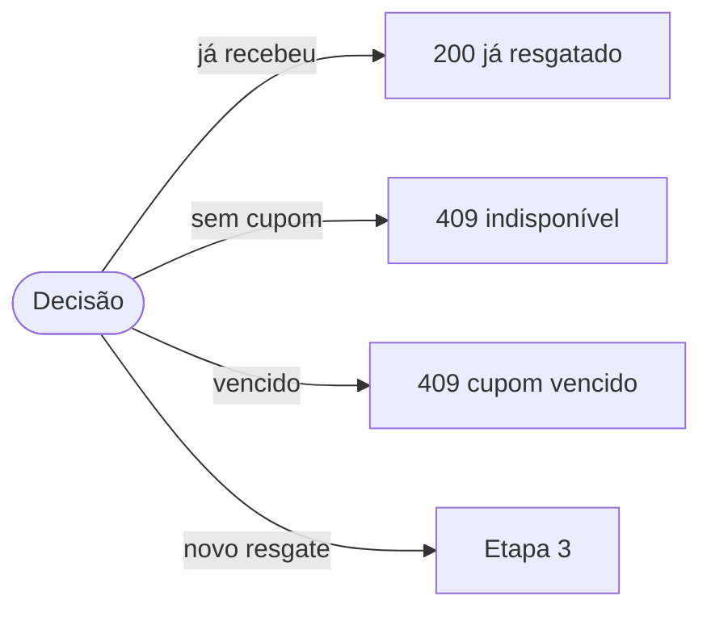
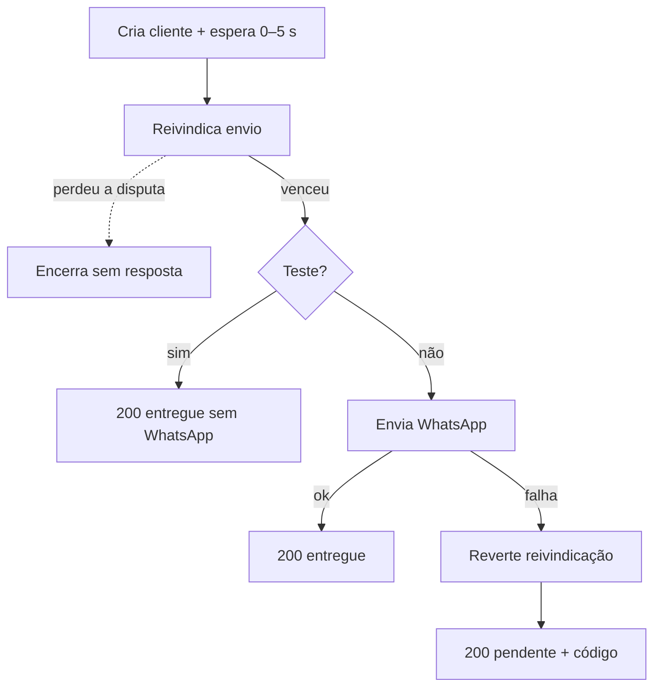
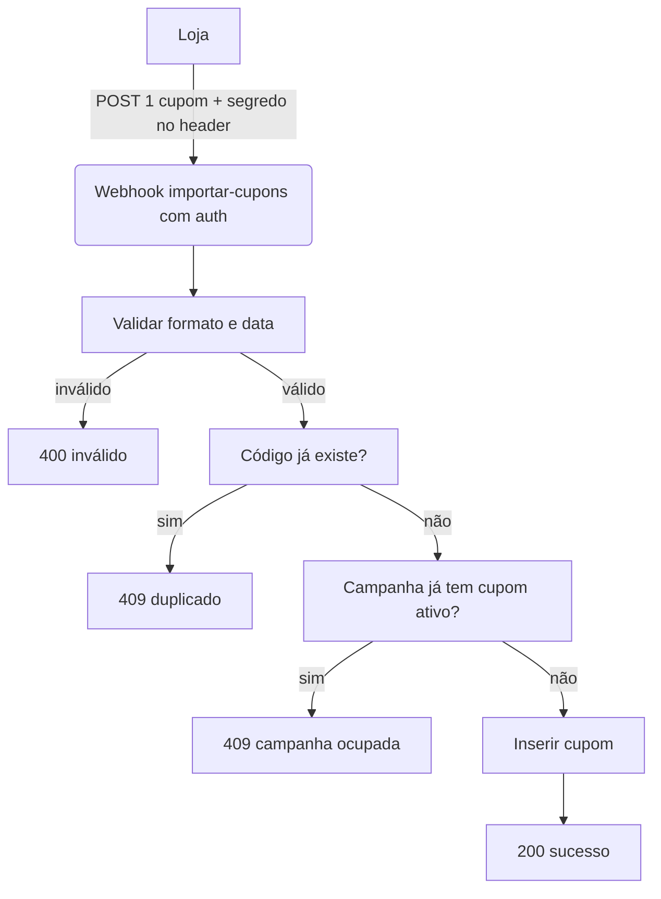

# Arquitetura

## Componentes

| Componente | Papel | Onde vive |
|---|---|---|
| Landing estática | 3 passos, máscara de telefone, raspadinha, cópia de cupom, espera de 45 s | `public/` (HTML, CSS, dois scripts) |
| Raspadinha | Canvas com foil dourado, limiar de 40%, botão alternativo | `public/scratchcard.js` |
| Fluxo de resgate | Valida dados, decide entrega, registra cliente, reivindica envio, chama WhatsApp | Automação n8n, exportada em `workflows/resgate-entrega-cupom.json` |
| Fluxo de importação | Recebe um cupom por chamada, valida formato, impede duplicata e campanha dupla | Automação n8n, exportada em `workflows/importacao-estoque-cupons.json` |
| Checagem de Instagram | Normaliza @ e consulta lista de seguidores (fora do resgate) | Automação n8n, exportada em `workflows/validacao-instagram.json` |
| Tabelas de dados | Estoque de cupons e cadastro de clientes | Tabelas nativas do n8n (`cupons`, `clientes`) |
| Gateway de WhatsApp | Envia a mensagem com o código | Serviço HTTP externo chamado pelo fluxo de resgate |
| Testes | Contrato, concorrência e proteções de ambiente de teste | `tests/` (Python e Node, só biblioteca padrão) |

O frontend conversa com a automação por um único webhook de resgate. A loja alimenta o estoque pelo webhook de importação. O gateway de WhatsApp só recebe chamadas do fluxo de resgate, nunca do navegador.

## Fluxo de dados do resgate

Etapa 1: validação e leitura.

Etapa 2: decisão. Três saídas encerram o pedido; só o novo resgate segue para entrega.

Etapa 3: entrega do novo resgate.

Pontos-chave do desenho:

- **Leitura antes da decisão.** Cupom ativo e cliente são lidos antes de qualquer escrita.
- **Reivindicação condicional.** A marcação de envio só acontece se o registro ainda estiver como não enviado. Duas chamadas simultâneas com o mesmo telefone: uma vence, a outra encerra sem resposta própria.
- **Espera aleatória curta.** Antes de reivindicar, o fluxo pausa de 0 a 5 segundos para reduzir colisão entre execuções simultâneas.
- **Falha de WhatsApp não perde o cupom.** Se o gateway falhar, a reivindicação é revertida e a resposta traz o código com estado pendente.
- **Erros de leitura viram 503.** Falhas nas tabelas respondem erro temporário sem expor dados pessoais.

## Fluxo de dados da importação

Uma campanha ativa comporta um cupom ativo por vez. Para trocar o cupom, desligue o atual antes de importar o novo [verificar].

## Estado publicado x arquivos locais

Os arquivos em `workflows/` na raiz são a referência documentada. Cópias sincronizadas do servidor ficam em `workflows/remote/` com manifesto de versão. Na última sincronização lida, nomes e conexões batiam; divergiam apenas ajustes de retenção de execuções e tempo-limite.
